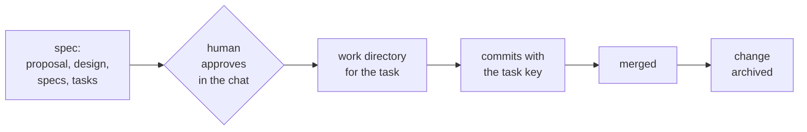

# Svod

Svod keeps coding agents on a process you can read. YAML pipelines describe the checks and human decisions your project actually needs. Svod computes the current position from files and Git instead of relying on a session's memory. Profiles choose the obligations; the framework does not require every task to use a tracker, CI, review or deployment ceremony.

The position is never remembered: every session recomputes it from the repository, so a new session, a teammate or a different agent (Claude Code or Codex) continues from the same place.



## How it works

A **pipeline** (`profile/pipelines/<kind>.yaml`) is an ordered list of steps for one kind of work. A step has **gates** — checks over files and git: "`design.md` exists", "the plan is approved and has not changed since", "a work directory has commits with the task key". The **position** of a piece of work is the first step whose gates do not pass. A step can freeze code (`blocks_code`): until it passes, Svod tells the agent not to touch the code, and a hook refuses the edit.

Approval is a human act. The person writes "approve PROJ-1" in the chat; the prompt hook leaves a short-lived mark; the agent records it with `svod approve PROJ-1`, which stores the date, the approver and a hash of the plan. Editing the plan afterwards invalidates the approval.

The hooks run as the same user as the agent. They stop a careless agent: an edit or a shell command into frozen code, a hand-written approval field or mark, a write while the store does not load. They do not stop a determined one, which can write any file the user can, and a profile gate is Python the hooks run: open a store you trust. Svod is process guidance with guard rails, not a security boundary.

The engine knows nothing about your team. Everything specific — pipelines, extra gates, texts, which skill does which step — lives in a **profile** next to `svod.yaml`.

## Quickstart: compact local work

Requires Python 3.10+ and Git. Install the current framework, then create a new store:

```bash
pip install git+https://github.com/MorinV/SVOD
svod new demo-store
cd demo-store
git init
svod init --login your-login
svod validate
svod render local
```

The bundled local profile uses contract → selected human approval → real command checks → local completion. It includes project instructions and task templates; follow [docs/local-workflow.md](docs/local-workflow.md) to create your first task. Source runs in an ordinary clean Git checkout, separate from task records and logs. An installed wheel and a vendored engine both contain the runtime helpers and templates.

Work on one selected task with `svod status tasks/<name>` (or `--format json`). Automatic whole-store context is disabled in the local template, but approval marking and edit guards are not disabled. Final checks run once on unchanged source; completion survives deletion of the disposable source checkout while still detecting damaged evidence. Local completion is not merge, push, installation or deployment.

The execution skill explains bounded reads, meaningful delegation and risk-proportionate verification. These are practical reductions in repeated work, not measured claims about token or time savings.

## OpenSpec/Git example

Requires Python 3.10+ and git.

```bash
pip install git+https://github.com/MorinV/SVOD       # or: pip install -e . from a clone

svod new demo-store --template task                   # svod.yaml and the example profile
cd demo-store && git init && git add -A && git commit -m "svod example"
svod init --login your-login
svod validate
```

Start a task. The example profile tracks [OpenSpec](https://github.com/Fission-AI/OpenSpec)-style changes and finds code in sibling git worktrees named `<repo>-<KEY>_<slug>`:

```bash
mkdir -p openspec/changes/add-login/specs/login
echo "key: PROJ-1" > openspec/changes/add-login/.openspec.yaml
touch openspec/changes/add-login/{proposal,design,tasks}.md openspec/changes/add-login/specs/login/spec.md
svod status PROJ-1
```

```
add-login (PROJ-1)
  + Propose
  + proposal   + design   + spec   + tasks
  - plan approved
  ...
  Next step: show the plan (proposal, design, specs, tasks) to the person and wait for the approval in the chat; then svod approve <key>.
  Do not touch the code: step approve has not passed.
```

After the approval, a work directory in a service repository next to the store moves the task on:

```bash
git -C ../app worktree add -b PROJ-1_login ../app-PROJ-1_login
svod status PROJ-1        # next: implement and commit with the key; then merge; then archive
svod active               # everything open, the summary an agent sees at session start
```

## Connect an agent

```bash
integrations/setup-claude.sh --project <store>  # hooks in <store>/.claude/settings.json, skills in <store>/.claude/skills
integrations/setup-claude.sh [<store>]           # hooks in ~/.claude/settings.json, skills in ~/.claude/skills
integrations/setup-codex.sh  [<store>]           # hooks in ~/.codex/hooks.json, skills in ~/.codex/skills
```

With `--project` the hooks run only in Claude Code sessions started in the store. Without it they run on every tool call in every project of yours, and the script warns about that; use it when sessions start in work directories outside the store. Both scripts keep a backup of the file they change and do nothing on a second run. Codex asks to trust new hooks on the next start; until you do, they do not run.

The hooks are `svod hook <event>`, registered as `<python> -m svod.cli hook <event>` with the absolute path of the Python that has `svod` installed (or with this clone on `PYTHONPATH` when none has); after switching to another Python or virtual environment, run the script again:

| Event | What the agent gets |
|---|---|
| session start | the summary of open work with the next step for each |
| prompt | the position of every task named in the prompt; an approval mark when the prompt is an approval phrase |
| before a tool call | a refusal to edit code of a task whose plan is not approved, to edit approval fields by hand, and optionally to edit the main checkout |

## Your own process

Start from `svod new <dir> --template task` or `--template local` ([the templates](svod/templates)), then change the pipeline: add a step, a gate, a text. The skill [`svod-pipeline`](svod/templates/local/skills/svod-pipeline/SKILL.md) walks an agent through it, and `svod validate` checks every declaration. Gates that do not exist yet are small Python classes in `profile/gates/`.

| Command | Does |
|---|---|
| `svod validate` | checks config, pipelines, gates, texts and bindings |
| `svod status <key or name>` | the position of one piece of work |
| `svod status <query> --format json` | bounded structured outcomes and advisory next action |
| `svod active` | everything open |
| `svod approve <key> [--step <id>]` | records the selected ready human approval |
| `svod new <directory> [--template local\|task]` | creates a new store without overwriting existing files |
| `svod local checks <query>`, `svod local deliver <query>` | observes a real local result, then records local completion |
| `svod render <pipeline> --write` | refreshes the pipeline diagram in your docs |
| `svod init` | creates the per-person local config |
| `svod install`, `svod update` | puts a release of the engine into the store, replaces it |

The full format — every key of `svod.yaml`, pipelines, steps, gates, providers, texts and hooks — is in [docs/reference.md](docs/reference.md).

## Updating

A team store can keep its own copy of the engine in `.svod/`, so everyone runs the version the store pins, whatever `svod` they installed:

```bash
svod install          # once: copy the newest release into .svod/, then commit it
svod update           # later: replace the copy, migrate the store, show the changelog; then review git diff and open a pull request
```

`svod validate` catches hand edits of the copy, and the session start summary says when a newer release is out. Closed networks, versions and migrations: [docs/updating.md](docs/updating.md); history: [CHANGELOG.md](CHANGELOG.md).

## Status

Early. Version 0.3 packages reusable local-workflow and context improvements from real project use. Existing profiles are not silently rewritten; expect the format to change before 1.0. See [CHANGELOG.md](CHANGELOG.md) for compatibility and migration boundaries. A source version is not a published release tag.

## License

Apache-2.0, see [LICENSE](LICENSE).
