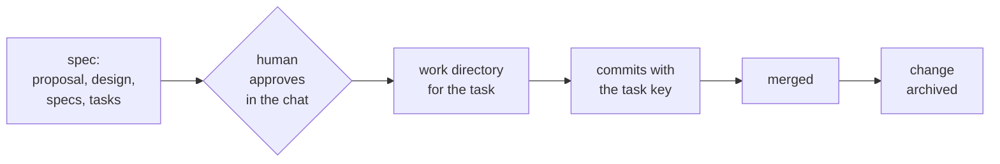

# Svod

Svod keeps coding agents on a process you can read. YAML pipelines describe the checks and human decisions your project actually needs. Svod computes the current position from files and Git instead of relying on a session's memory. Profiles choose the obligations; the framework does not require every task to use a tracker, CI, review or deployment ceremony.

The position is never remembered: every session recomputes it from the repository, so a new session, a teammate or a different agent (Claude Code or Codex) continues from the same place.



## How it works

A **pipeline** (`profile/pipelines/<kind>.yaml`) is an ordered list of steps for one kind of work. A step has **gates** — checks over files and git: "`design.md` exists", "the plan is approved and has not changed since", "a work directory has commits with the task key". The **position** of a piece of work is the first step whose gates do not pass. A step can freeze code (`blocks_code`): until it passes, Svod tells the agent not to touch the code, and a hook refuses the edit.

Approval is a human act. The person writes "approve PROJ-1" in the chat; the prompt hook leaves a short-lived mark; the agent records it with `svod approve PROJ-1`, which stores the date, the approver and a hash of the plan. Editing the plan afterwards invalidates the approval.

The hooks run as the same user as the agent. They stop a careless agent: an edit or a shell command into frozen code, a hand-written approval field or mark, a write while the store does not load. They do not stop a determined one, which can write any file the user can, and a profile gate is Python the hooks run: open a store you trust. Svod is process guidance with guard rails, not a security boundary.

The engine knows nothing about your team. Everything specific — pipelines, extra gates, texts, which skill does which step — lives in a **profile** next to `svod.yaml`.

## Quickstart

Requires Python 3.10+ and Git. An instance of Svod is a store next to your project repositories:

```bash
pip install git+https://github.com/MorinV/SVOD@v0.7.0
svod setup ~/Projects/svod
```

`svod setup` makes the standard-template store, a git repository with a first commit, the copy of the engine in `.svod/` (taken from where pip installed `svod`, here `v0.7.0`; `--from`, `--to` choose another) and the Claude Code hooks. At a terminal it asks your login and email, the services, the autonomy of each pipeline, their check commands and where to register the hooks; every answer can be a flag (`--login me --service app=../app --hooks project`).

Put the project repositories next to it and name them as services:

```bash
git clone <your repository> ~/Projects/app
cd ~/Projects/svod && svod init --service app=../app && svod doctor
```

The first task: start Claude Code in `~/Projects/svod` and ask for the task. The agent writes `work/tasks/<name>/card.md` after `work/tasks/example/`, the questions and the contract; you approve in the chat ("Approved <name>"); then the worktree of each service is made by

```bash
svod do start-task work/tasks/<name>      # a worktree per service, listed in work.yaml
svod status work/tasks/<name>             # where the task stands and what is next
```

The store is a dispatcher: records live in `work/projects`, `work/features`, `work/tasks` (a hotfix is a task with `kind: hotfix`) and `work/research`; the code stays in the services. A task goes card → questions → contract → approval → worktrees → checks (`svod do checks`) → delivery → `status: done`; each step names its skill (`svod-task`, `svod-feature`, `svod-project`, `svod-research`, `svod-questions`). Details: the `README.md` of the new store and [docs/reference.md](docs/reference.md#setup).

**Svod develops itself with Svod.** The instance [MorinV/svod-rnd](https://github.com/MorinV/svod-rnd) is a standard-template store next to a clone of this repository: the work on the engine is recorded there as features, tasks and research, with their questions, contracts, approvals and evidence log. The layout and what the first runs found: [docs/dogfooding.md](docs/dogfooding.md).

## OpenSpec/Git example

Requires Python 3.10+ and git.

```bash
pip install git+https://github.com/MorinV/SVOD       # or: pip install -e . from a clone

svod new demo-store --template task                   # svod.yaml and the example profile
cd demo-store && git init && git add -A && git commit -m "svod example"
svod init --login your-login
svod validate
```

Start a task. The example profile tracks [OpenSpec](https://github.com/Fission-AI/OpenSpec)-style changes and finds code in sibling git worktrees named `<repo>-<KEY>_<slug>`:

```bash
mkdir -p openspec/changes/add-login/specs/login
echo "key: PROJ-1" > openspec/changes/add-login/.openspec.yaml
touch openspec/changes/add-login/{proposal,design,tasks}.md openspec/changes/add-login/specs/login/spec.md
svod status PROJ-1
```

```
add-login (PROJ-1)
  + Propose
  + proposal   + design   + spec   + tasks
  - plan approved
  ...
  Next step: show the plan (proposal, design, specs, tasks) to the person and wait for the approval in the chat; then svod approve <key>.
  Do not touch the code: step approve has not passed.
```

After the approval, a work directory in a service repository next to the store moves the task on:

```bash
git -C ../app worktree add -b PROJ-1_login ../app-PROJ-1_login
svod status PROJ-1        # next: implement and commit with the key; then merge; then archive
svod active               # everything open, the summary an agent sees at session start
```

## Connect an agent

Optional requirements analysis: [svod-fret skill](svod/skills/svod-fret/SKILL.md)
and [Docker launcher instructions](svod/skills/svod-fret/references/usage.md).
Use only when explicitly selected for interacting temporal/stateful requirements;
ordinary SVOD needs neither Docker nor FRET. The tool is experimental, not a gate.

```bash
integrations/setup-claude.sh --project <store>  # hooks in <store>/.claude/settings.json, skills in <store>/.claude/skills
integrations/setup-claude.sh [<store>]           # hooks in ~/.claude/settings.json, skills in ~/.claude/skills
integrations/setup-codex.sh  [<store>]           # hooks in ~/.codex/hooks.json, skills in ~/.codex/skills
```

With `--project` the hooks run only in Claude Code sessions started in the store. Without it they run on every tool call in every project of yours, and the script warns about that; use it when sessions start in work directories outside the store. Both scripts keep a backup of the file they change and do nothing on a second run. The skills linked are the store's own `skills/` when it has any, else those of its copy of the engine (`.svod/skills/`), else the engine's [`svod/skills/`](svod/skills): `svod-pipeline` for changing the process, `svod-efficient-execution` for running one record with one run of its checks. Codex asks to trust new hooks on the next start; until you do, they do not run.

The hooks are `svod hook <event>`, registered as `<python> -m svod.cli hook <event>` with the absolute path of the Python that has `svod` installed (or with this clone on `PYTHONPATH` when none has); after switching to another Python or virtual environment, run the script again:

| Event | What the agent gets |
|---|---|
| session start | the summary of open work with the next step for each |
| prompt | the position of every task named in the prompt; an approval mark when the prompt is an approval phrase |
| before a tool call | a refusal to edit code of a task whose plan is not approved, to edit approval fields by hand, and optionally to edit the main checkout |

**Knowledge.** What the team has learned is kept as notes in `knowledge/<topic>.md` with `title`, `tags`, `source`, `date` and `status` in the frontmatter, written by research or by `svod knowledge add <file>` and `svod knowledge note "<text>"`, and listed in `knowledge/INDEX.md` by `svod knowledge index`. At session start and on a prompt naming a task, the hooks add the title, path and first line of every current note sharing a tag with that work, so the agent sees what is already known without searching for it. `profile_config.agent_context.knowledge: false` turns this off; the format and the keys are in [docs/reference.md](docs/reference.md#knowledge).

## Your own process

Start from `svod new <dir> --template standard|task` ([the templates](svod/templates)), then change the pipeline: add a step, a gate, a text. The skill [`svod-pipeline`](svod/skills/svod-pipeline/SKILL.md) walks an agent through it, and `svod validate` checks every declaration. Gates that do not exist yet are small Python classes in `profile/gates/`.

| Command | Does |
|---|---|
| `svod validate` | checks config, pipelines, gates, texts and bindings |
| `svod status <key or name>` | the position of one piece of work |
| `svod status <query> --format json` | bounded structured outcomes and advisory next action |
| `svod active` | everything open |
| `svod approve <key> [--step <id>]` | records the selected ready human approval |
| `svod new <directory> [--template standard\|task]` | creates a new store without overwriting existing files; `standard` by default |
| `svod render <pipeline> --write` | refreshes the pipeline diagram in your docs |
| `svod init [--wizard]` | creates the per-person local config; `--wizard` also sets services, autonomy, checks and hooks |
| `svod doctor [--format json]` | checks that the store is ready to work in, one ok, warn or fail line per check |
| `svod install`, `svod update` | puts a release of the engine into the store, replaces it |

The full format — every key of `svod.yaml`, pipelines, steps, gates, providers, texts and hooks — is in [docs/reference.md](docs/reference.md).

## Updating

A team store can keep its own copy of the engine in `.svod/`, so everyone runs the version the store pins, whatever `svod` they installed:

```bash
svod install          # once: copy the newest release into .svod/, then commit it
svod update           # later: replace the copy, migrate the store, show the changelog; then review git diff and open a pull request
```

`svod validate` catches hand edits of the copy, and the session start summary says when a newer release is out. Closed networks, versions and migrations: [docs/updating.md](docs/updating.md); history: [CHANGELOG.md](CHANGELOG.md).

## Status

Early. Version 0.7 adds exact-set contract approval packages, scoped external write grants, opt-in trusted actions, bounded retrospective application and knowledge publication/supersession. Status JSON omits empty optional fields; pass `--children` for child details. Version 0.6 made an instance easy to set up and keep: `svod setup` in one command, `svod update` that merges the profile from the template, releases from CI, a session index instead of a full summary, `svod next`, `svod record new`, `svod report`, a cheap `svod status`; the local template is gone. Version 0.5 made the store a dispatcher over several service repositories: the standard template with project, feature, task and research pipelines, questions before work, actions as scripts, a command gate, autonomy levels, an evidence log with a retrospective, and a knowledge base. Svod develops itself through its own store. Every new key of `svod.yaml` is optional for an existing store; expect the format to change before 1.0. Compatibility and migration notes: [CHANGELOG.md](CHANGELOG.md).

## License

Apache-2.0, see [LICENSE](LICENSE).
