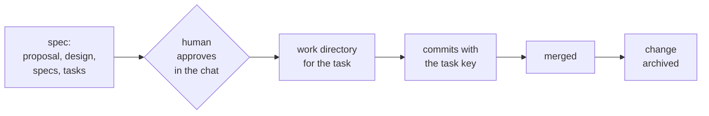

# Svod

Svod keeps coding agents on a process you can read. You describe how work flows — a spec, a human approval, code in its own directory, a merge — as YAML pipelines. Svod computes where each piece of work stands from files and git, tells the agent the next step, and stops it from touching code before the plan is approved.

The position is never remembered: every session recomputes it from the repository, so a new session, a teammate or a different agent (Claude Code or Codex) continues from the same place.



## How it works

A **pipeline** (`profile/pipelines/<kind>.yaml`) is an ordered list of steps for one kind of work. A step has **gates** — checks over files and git: "`design.md` exists", "the plan is approved and has not changed since", "a work directory has commits with the task key". The **position** of a piece of work is the first step whose gates do not pass. A step can freeze code (`blocks_code`): until it passes, Svod tells the agent not to touch the code, and a hook refuses the edit.

Approval is a human act. The person writes "approve PROJ-1" in the chat; the prompt hook leaves a short-lived mark; the agent records it with `svod approve PROJ-1`, which stores the date, the approver and a hash of the plan. Editing the plan afterwards invalidates the approval.

The engine knows nothing about your team. Everything specific — pipelines, extra gates, texts, which skill does which step — lives in a **profile** next to `svod.yaml`.

## Quickstart

Requires Python 3.10+ and git.

```bash
pip install git+https://github.com/<owner>/svod      # or: pip install -e . from a clone

git init demo-store && cd demo-store
cp -R <svod>/examples/task/. .                        # svod.yaml and an example profile
git add -A && git commit -m "svod example"
svod validate
```

Start a task. The example profile tracks [OpenSpec](https://github.com/Fission-AI/OpenSpec)-style changes and finds code in sibling git worktrees named `<repo>-<KEY>_<slug>`:

```bash
mkdir -p openspec/changes/add-login/specs/login
echo "key: PROJ-1" > openspec/changes/add-login/.openspec.yaml
touch openspec/changes/add-login/{proposal,design,tasks}.md openspec/changes/add-login/specs/login/spec.md
svod status PROJ-1
```

```
add-login (PROJ-1)
  + proposal   + design   + spec   + tasks
  - plan approved
  ...
  Next step: show the plan (proposal, design, specs, tasks) to the person and wait for the approval in the chat; then svod approve <key>.
  Do not touch the code: step approve has not passed.
```

After the approval, a work directory in a service repository next to the store moves the task on:

```bash
git -C ../app worktree add -b PROJ-1_login ../app-PROJ-1_login
svod status PROJ-1        # next: implement and commit with the key; then merge; then archive
svod active               # everything open, the summary an agent sees at session start
```

## Connect an agent

```bash
integrations/setup-claude.sh [<store>]    # hooks in ~/.claude/settings.json, skills in ~/.claude/skills
integrations/setup-codex.sh  [<store>]    # hooks in ~/.codex/hooks.json, skills in ~/.codex/skills
```

Both scripts keep a backup of the file they change and do nothing on a second run. Codex asks to trust new hooks on the next start; until you do, they do not run.

The hooks are `svod hook <event>`:

| Event | What the agent gets |
|---|---|
| session start | the summary of open work with the next step for each |
| prompt | the position of every task named in the prompt; an approval mark when the prompt is an approval phrase |
| before a tool call | a refusal to edit code of a task whose plan is not approved, to edit approval fields by hand, and optionally to edit the main checkout |

## Your own process

Copy `examples/task`, then change the pipeline: add a step, a gate, a text. The skill [`svod-pipeline`](skills/svod-pipeline/SKILL.md) walks an agent through it, and `svod validate` checks every declaration. Gates that do not exist yet are small Python classes in `profile/gates/`.

| Command | Does |
|---|---|
| `svod validate` | checks config, pipelines, gates, texts and bindings |
| `svod status <key or name>` | the position of one piece of work |
| `svod active` | everything open |
| `svod approve <key>` | records a human approval |
| `svod render <pipeline> --write` | refreshes the pipeline diagram in your docs |
| `svod init` | creates the per-person local config |
| `svod install`, `svod update` | puts a release of the engine into the store, replaces it |

The full format — every key of `svod.yaml`, pipelines, steps, gates, providers, texts and hooks — is in [docs/reference.md](docs/reference.md).

## Updating

A team store can keep its own copy of the engine in `.svod/`, so everyone runs the version the store pins, whatever `svod` they installed:

```bash
svod install          # once: copy the newest release into .svod/, then commit it
svod update           # later: replace the copy, migrate the store, show the changelog; then review git diff and open a pull request
```

`svod validate` catches hand edits of the copy, and the session start summary says when a newer release is out. Closed networks, versions and migrations: [docs/updating.md](docs/updating.md); history: [CHANGELOG.md](CHANGELOG.md).

## Status

Early. The engine has run a real team's process for several weeks; this repository is its first public cut. Expect the format to change before 1.0.

## License

Apache-2.0, see [LICENSE](LICENSE).
