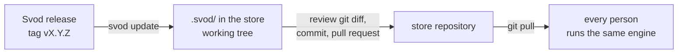

# Keeping Svod up to date in a team

A team store can carry its own copy of the engine in `.svod/`. Everyone who clones the store runs that copy, whatever version of `svod` they installed: the version of the engine is decided by the store and changes through an ordinary pull request.



## Start using a copy

Every person still installs `svod` once (`pip install …`); it finds the store and hands each command over to the copy of the store. The hooks the setup scripts register run the installed engine as `<python> -m svod.cli`, with the absolute path of the Python it is installed in, and it hands over the same way; after moving `svod` to another Python or virtual environment, run the setup script again. The hand-over exists since 0.2.0: an installed 0.1.0 ignores `.svod/` and runs its own code, so everyone needs `svod` 0.2.0 or newer — `svod --version` outside a store shows the installed one.

One person adds the copy:

```bash
cd <store>
svod install                     # the newest release of the Svod repository
git add .svod && git commit -m "Svod engine copy"
```

`svod install` refuses when `.svod/` already exists; then it is `svod update`. Run the setup scripts again with the store as the argument (`integrations/setup-claude.sh <store>`) to link the skills of the copy instead of those of your Svod clone; a store with its own `skills/<name>/SKILL.md` (the standard template) keeps linking those.

What lands in the store:

| path | content |
|---|---|
| `.svod/lib/svod/` | the engine |
| `.svod/skills/` | the skills of the release |
| `.svod/VERSION` | version, the source it came from, the tag |
| `.svod/MANIFEST` | sha256 of every file above |

## Update

```bash
svod update                      # the newest release of the recorded source
svod update --to v0.4.0          # a given tag
```

`update` fetches the tag into a temporary directory, replaces `.svod/` in one rename, then with the new engine applies the migrations of the store, validates it, and prints the changelog between the old and the new version with its **Migration** notes. It never commits:

1. read the output: a failed validation or a manual migration step comes first;
2. `git diff` — the copy, and any file a migration changed;
3. commit and open a pull request; once merged, everyone runs the new version after `git pull`.

When a fetch fails (network, unknown tag), the store is left exactly as it was.

At session start the agent is told when a newer release is out (`Svod X is available (store uses Y): svod update`), checked at most once a day. A failed check says nothing. `update_check: false` in `svod.yaml` turns it off.

## "vendored copy modified"

`svod validate` compares `.svod/` with its `MANIFEST`. A file changed, added or removed by hand is an error:

```
vendored copy modified: lib/svod/cli.py; run svod update --to v0.2.0 to restore
```

Do not patch the copy: the next update overwrites it. Restore it with the command from the message (the same tag puts back exactly the released files), or `git checkout -- .svod`. A change the engine needs goes upstream into Svod, and the store gets it with the next release.

## Closed networks

`--from` takes a local path as well as a git URL. Keep a clone of the Svod repository where the store can reach it and point at it:

```bash
git -C /mirror/svod fetch --tags        # wherever the mirror is refreshed
svod update --from /mirror/svod --to v0.4.0
```

The path is cloned too, so exactly the tag is taken, and it is recorded as the source: later `svod update` and the session start notice use it. Pass `--from` again to switch sources.

## Nested work-layout transition

The standard profile now places task/research under projects or features (including
features inside projects), unowned work under `work/headless/{tasks,research}`,
and hotfixes under `work/hotfix`. Research outcomes are knowledge, task or research;
research provenance is not containment. Engine installation alone does **not** move
existing records or grant permission to replace a customized profile.

Follow the shipped [svod-task-layout-transition instruction](../svod/skills/svod-task-layout-transition/SKILL.md)
and [mapping worksheet](../svod/skills/svod-task-layout-transition/references/mapping.md).
They are in `.svod/skills/svod-task-layout-transition/` for bundled installs or
`svod/skills/svod-task-layout-transition/` in the shared/source package. Store skills
can mask engine skills during agent setup; read the explicit path rather than
replacing local policy. Authorize engine/profile/content changes separately.

Inventory all records, including done, archived and Git-untracked; preflight an
explicit old/new mapping for collisions, then rehearse on an isolated complete copy.
Update live card/link/plan references, not historical evidence wholesale. Preserve
original historical artifacts and approval bytes; report changed-bound-input drift,
never rewrite approval hashes or replay consent. Keep work.yaml and existing
worktree/branch names unchanged. Verify counts, file bytes, references and native
commands, repeat read-only reconciliation, then apply live only with authorization.
No permanent legacy alias registry is introduced; retain finite transition evidence.

## Versions and migrations

Version 0.3 adds a compact local profile, packaged templates (`svod new`) and local command helpers. Updating the engine does not install or overwrite a project's profile: opt into a new store or adapt selected declarations explicitly. Update the engine before using `when`, `purpose` or new CLI commands. Existing human decisions and logs remain history; no automatic consent or lifecycle import is performed. Stricter readiness/timestamp checks can require presenting inputs again and obtaining a fresh human answer.

Version 0.4 changes no store format. The skills of a Svod clone moved into the local template: run the setup scripts again so the links point there.

Version 0.6 retires the local template and `svod local prepare|checks|verify|deliver`; `svod new` makes a `standard` store by default and refuses `--template local`. An instance made from the local template recreates itself from the standard one: `svod new <directory> --template standard`, copy its records into `work/` (cards, contracts, approvals, logs), then `svod install` there. The engine skills `svod-pipeline` and `svod-efficient-execution` moved to `svod/skills/`: run the setup scripts again so the links of a clone point there; links into `.svod/skills/` keep working after `svod update`.

Releases are made by CI, never by hand: nobody pushes a tag. A push to `main` that changes `svod/__init__.py` runs `.github/workflows/release.yml`, which reads the version there, takes the section `## [<version>]` of [CHANGELOG.md](../CHANGELOG.md) (the engine's own parser, `svod/changelog.py`), creates the annotated tag `v<version>` on that commit and a GitHub Release `v<version>` with the section as its body; nothing goes to PyPI. A version that is already released is skipped, and a version without its section fails the run. To release a version, bump `__version__` and move the Unreleased entries into `## [<version>]` with a **Migration** subsection in the same change. The workflow can also be run by hand (Actions, `release`, Run workflow) with the full sha of a commit of `main` as `ref`, for a release whose version change reached `main` before the workflow did: `v0.4.0` is commit `8a9851fffec3a6a110b2a5a9983fb8aab2316f6c` and `v0.5.0` is `578a9d5d35a1090d509808abcf5a61c89e41c774`, run in that order so `v0.5.0` is the latest. Without `ref` it releases the head of `main`.

`svod install` and `svod update` without `--to` take the newest `vX.Y.Z` tag, and the session start notice compares the copy of a store with it; until a tag exists they find no release and stop, and `--to` takes a branch or a tag in the meantime. A commit on `main` that does not change the version publishes nothing.

- Versions are semantic: `MAJOR.MINOR.PATCH`, tags `vX.Y.Z`. Before 1.0 a minor release (`0.3.0`) may change the format of a store; a patch release (`0.2.1`) does not.
- Every release in [CHANGELOG.md](../CHANGELOG.md) has a **Migration** subsection: what changes in a store and what to do by hand; `none` when nothing.
- What can be done automatically (renaming a key of `svod.yaml`, moving a file) is a migration in `svod/migrations.py`. `svod update` applies those of every version after the old one up to the new one, oldest first, and prints what it changed. They are ordinary changes of the working tree: review them in `git diff` like the copy.
- Skipping releases is fine: one `svod update` runs all the migrations in between.
- To apply them by hand: `svod migrate --since <old version>`.

The full format is in [reference.md](reference.md#vendored-copy).
