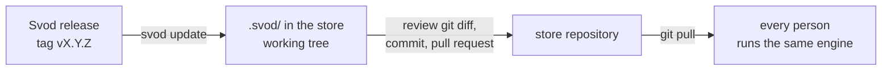

# Keeping Svod up to date in a team

A team store can carry its own copy of the engine in `.svod/`. Everyone who clones the store runs that copy, whatever version of `svod` they installed: the version of the engine is decided by the store and changes through an ordinary pull request.



## Start using a copy

Every person still installs `svod` once (`pip install …`); it finds the store and hands each command over to the copy of the store. Hooks and setup scripts keep calling plain `svod`.

One person adds the copy:

```bash
cd <store>
svod install                     # the newest release of the Svod repository
git add .svod && git commit -m "Svod engine copy"
```

`svod install` refuses when `.svod/` already exists; then it is `svod update`. Run the setup scripts again with the store as the argument (`integrations/setup-claude.sh <store>`) to link the skills of the copy instead of those of your Svod clone.

What lands in the store:

| path | content |
|---|---|
| `.svod/lib/svod/` | the engine |
| `.svod/skills/` | the skills of the release |
| `.svod/VERSION` | version, the source it came from, the tag |
| `.svod/MANIFEST` | sha256 of every file above |

## Update

```bash
svod update                      # the newest release of the recorded source
svod update --to v0.3.0          # a given tag
```

`update` fetches the tag into a temporary directory, replaces `.svod/` in one rename, then with the new engine applies the migrations of the store, validates it, and prints the changelog between the old and the new version with its **Migration** notes. It never commits:

1. read the output: a failed validation or a manual migration step comes first;
2. `git diff` — the copy, and any file a migration changed;
3. commit and open a pull request; once merged, everyone runs the new version after `git pull`.

When a fetch fails (network, unknown tag), the store is left exactly as it was.

At session start the agent is told when a newer release is out (`Svod X is available (store uses Y): svod update`), checked at most once a day. A failed check says nothing. `update_check: false` in `svod.yaml` turns it off.

## "vendored copy modified"

`svod validate` compares `.svod/` with its `MANIFEST`. A file changed, added or removed by hand is an error:

```
vendored copy modified: lib/svod/cli.py; run svod update --to v0.2.0 to restore
```

Do not patch the copy: the next update overwrites it. Restore it with the command from the message (the same tag puts back exactly the released files), or `git checkout -- .svod`. A change the engine needs goes upstream into Svod, and the store gets it with the next release.

## Closed networks

`--from` takes a local path as well as a git URL. Keep a clone of the Svod repository where the store can reach it and point at it:

```bash
git -C /mirror/svod fetch --tags        # wherever the mirror is refreshed
svod update --from /mirror/svod --to v0.3.0
```

The path is cloned too, so exactly the tag is taken, and it is recorded as the source: later `svod update` and the session start notice use it. Pass `--from` again to switch sources.

## Versions and migrations

- Versions are semantic: `MAJOR.MINOR.PATCH`, tags `vX.Y.Z`. Before 1.0 a minor release (`0.3.0`) may change the format of a store; a patch release (`0.2.1`) does not.
- Every release in [CHANGELOG.md](../CHANGELOG.md) has a **Migration** subsection: what changes in a store and what to do by hand; `none` when nothing.
- What can be done automatically (renaming a key of `svod.yaml`, moving a file) is a migration in `svod/migrations.py`. `svod update` applies those of every version after the old one up to the new one, oldest first, and prints what it changed. They are ordinary changes of the working tree: review them in `git diff` like the copy.
- Skipping releases is fine: one `svod update` runs all the migrations in between.
- To apply them by hand: `svod migrate --since <old version>`.

The full format is in [reference.md](reference.md#vendored-copy).
